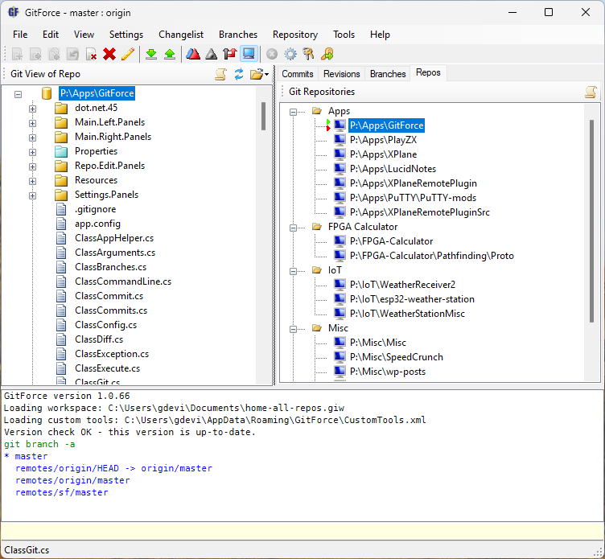

# GitForce (.NET 10)

GitForce est une interface graphique pour l'outil en ligne de commande **git**, pour Windows.

> **Fork** de [gdevic/GitForce](https://github.com/gdevic/GitForce) par Goran Devic, distribué
> comme l'original sous licence **GPLv3** (voir [LICENSE](LICENSE)).
> Cette version a été portée sur .NET 10 et enrichie des fonctions décrites ci-dessous.
> Les problèmes de cette version sont à signaler sur ce dépôt, pas sur le dépôt d'origine.



## Modifications par rapport à GitForce d'origine

### Plateforme
* Projet converti au format SDK, solution `.slnx`, cible **.NET 10** (`net10.0-windows`, 64 bits)
* Publication en **un seul exécutable** (`GitForce.exe`) et **installeur Inno Setup** (`installer/GitForce.iss`)
* Corrections des régressions liées au passage à .NET 10 (ouverture des fichiers et des liens,
  menus contextuels, liens de la description d'un commit, `Thread.Abort`, version de l'exécutable)
* Windows uniquement : la version Mono/Linux de l'original n'est plus prise en charge

### Fenêtre principale
* Nouvelle disposition : arbre des fichiers à gauche, onglets à droite, **diff du fichier sélectionné en bas**
* Onglet **Graph** : graphe des commits de toutes les branches (voies, fusions, étiquettes de branches,
  de tags et de **stashes**)
* Onglet **Log** pour le log des commandes git (« Log (!) » après une erreur)
* Liste des **fichiers d'un commit ou d'un stash** au clic dans Revisions ou Graph, avec un menu
  contextuel : historique, **Blame**, ouverture, Revert File, Cherry Pick File, Save Patch
* Onglet Branches : dernier commit de chaque branche (SHA, tags, sujet)
* **Thème clair / sombre** (View > Theme), **taille des icônes** de la barre d'outils (View > Toolbar Icons)

### Outils intégrés (plus besoin d'outils externes)
* **Comparateur (diff)** côte à côte ou unifié, avec **colorisation syntaxique** (C#, C, C++, Python)
* **Visualiseur** de fichiers texte, code source (numéros de ligne, colorisation, recherche) et images
* **Résolveur de conflits de merge** (ours / theirs / les deux / édition libre)
* Les outils externes (WinMerge, KDiff3, Meld…) restent utilisables s'ils sont configurés

### Git
* **Stage / Unstage** de fichiers et de dossiers
* **Ignore / Unignore** (.gitignore), icône et vue dédiées aux fichiers ignorés
* Vue **Changed Files** : tous les fichiers modifiés en une liste plate
* Merge de branches avec résolution des conflits intégrée
* **Modifier le message d'un commit**, renommer une branche, créer / renommer / supprimer des tags
* **Stash** de fichiers choisis (modes Discard, Keep index, Keep all, message), fenêtre Unstash
  (Apply, Pop, Drop, modification du message, branche depuis un stash)

### Documentation
* **Guide de démarrage en français** intégré (Help > Guide de démarrage)

## Compilation

Prérequis : [SDK .NET 10](https://dotnet.microsoft.com/download) et [Git pour Windows](https://git-scm.com/download/win).

```
dotnet build GitForce.slnx -c Release
```

Exécutable unique (dans `src/bin/Release/net10.0-windows/publish/win-x64/`) :

```
dotnet publish src/GitForce.csproj -p:PublishProfile=FolderProfile
```

Installeur (nécessite [Inno Setup 6](https://jrsoftware.org/isinfo.php)), créé dans `installer/Output/` :

```
"%LOCALAPPDATA%\Programs\Inno Setup 6\ISCC.exe" installer\GitForce.iss
```

Tout le code source est dans `src/`.

## Fonctions d'origine

* Intuitive GUI with drag and drop
* Create and manage multiple git repos, easy scan for local repos
* Supports multiple remote repos
* Multiple workspaces which are sets of repos; repos can be combined into Projects
* Multiple sets of changes independent of a single "index" mandated by the git design
* Add custom tools to context menus to customize it to your specific needs
* Easy manage SSH keys and remotes
* See files' revision history, stash, unstash etc.
* Manage local and remote branches
* Submodule support: detect, initialize, reset, and add submodules to repos list
* Integrated git command line interface if you still want to use it
* Users familiar with Perforce will find this UI very familiar

Documentation d'origine (en anglais) : [baltazarstudios.com/software/gitforce](https://baltazarstudios.com/software/gitforce)

## Licence

GNU General Public License v3.0 — voir [LICENSE](LICENSE).
Copyright © Goran Devic pour GitForce d'origine ; les modifications de ce fork sont distribuées sous la même licence.
